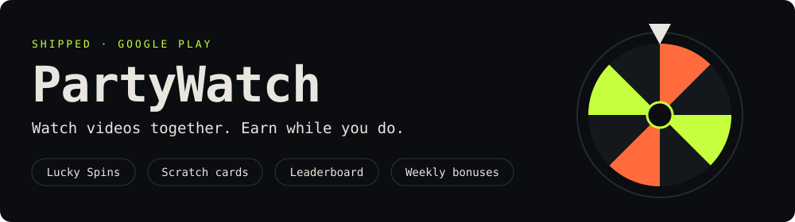
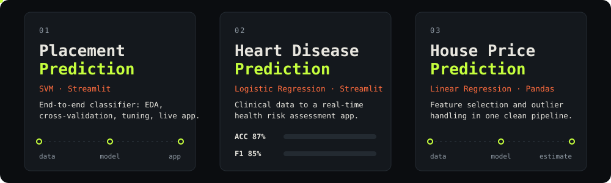

[README (1).md](https://github.com/user-attachments/files/34371883/README.1.md)
 

  

 

<h3 align="center">Turning data into intelligence. Turning ideas into products.</h3>

  B.Sc. Information Technology · Jai Hind College, Mumbai
   
  Aspiring AI/ML Engineer | Building practical machine learning applications

  <a href="mailto:owaiskazi838@gmail.com">Email</a> ·
  <a href="https://www.linkedin.com/in/owais-kazi-558939242/">LinkedIn</a> ·
  <a href="https://play.google.com/store/apps/details?id=com.partywatch.mobile">PartyWatch</a>

---

## About me

I'm an IT undergraduate interested in machine learning, data science and AI engineering.

I enjoy understanding problems, exploring datasets, building predictive models and turning those models into usable applications.

My approach goes beyond training a model. I focus on the complete workflow:

- Data collection, cleaning and exploratory analysis.
- Feature engineering and model development.
- Model evaluation, experimentation and hyperparameter tuning.
- Building interfaces and deploying applications.

Currently strengthening my foundations in machine learning while exploring NLP, deep learning and practical AI engineering.

**Open to AI/ML, Data Science and Software Engineering internship opportunities.**

## Beyond ML: Building real products

### PartyWatch — Published Android Application

Built and launched PartyWatch, a social watch-party application.

My responsibilities include:
- Product development and feature planning.
- React, TypeScript and Ionic Capacitor.
- Supabase authentication and backend integration.
- Real-time interactions and YouTube API integration.
- Product growth, monetization and user experience.

This experience taught me how to build, ship and maintain an application beyond the development environment.

[View on Google Play →](https://play.google.com/store/apps/details?id=com.partywatch.mobile)

## Leadership & collaboration

**WebOps & Hackathon Team — Sub Head**  
DotComClub, Jai Hind College

Working with a team to develop and maintain the club's digital presence.

- Developing the official website using Next.js, React and TypeScript.
- Integrating Convex backend functionality for registrations, newsletters, polls and submissions.
- Building interactive experiences using Three.js, React Three Fiber, Framer Motion and GSAP.
- Collaborating on technical execution and website development.

## Tech stack

**Languages**
- Python, SQL, JavaScript, TypeScript, Java

**Data Science & Machine Learning**
- NumPy, Pandas, Scikit-learn
- Matplotlib, Seaborn
- Exploratory Data Analysis
- Data Preprocessing & Feature Engineering
- Regression, Classification & Model Evaluation

**Development & Deployment**
- Streamlit, FastAPI (learning)
- React, Next.js, Node.js
- Supabase, Convex
- Git & GitHub

**Currently exploring**
- Natural Language Processing
- Deep Learning
- LLM Engineering
- ML Model Deployment & MLOps

## GitHub activity

  
  

---

  <b>Learning continuously. Building consistently. Shipping real products.</b>
    
  Let's connect and build something meaningful.

## projects

  <a href="https://github.com/Kazi-Owais/Placement_Prediction_System">placement prediction</a> &nbsp;·&nbsp;
  <a href="https://github.com/Kazi-Owais/heart_disease">heart disease prediction</a> &nbsp;·&nbsp;
  <a href="https://github.com/Kazi-Owais/house_price_prediction">house price prediction</a>

## shipped

I build and market it on my own: product, growth, ads, the lot.

## building with a team

**WebOps & Hackathon Team, Sub Head** at DotComClub (DCC), Jai Hind College

- Run the club's official website: Next.js, React, TypeScript, Tailwind CSS.
- Convex backend for event registrations, newsletters, contact forms, polling and e-waste submissions.
- 3D visuals and UI animation with Three.js / React Three Fiber, Framer Motion and GSAP.

## toolbox

## signal

  
  

